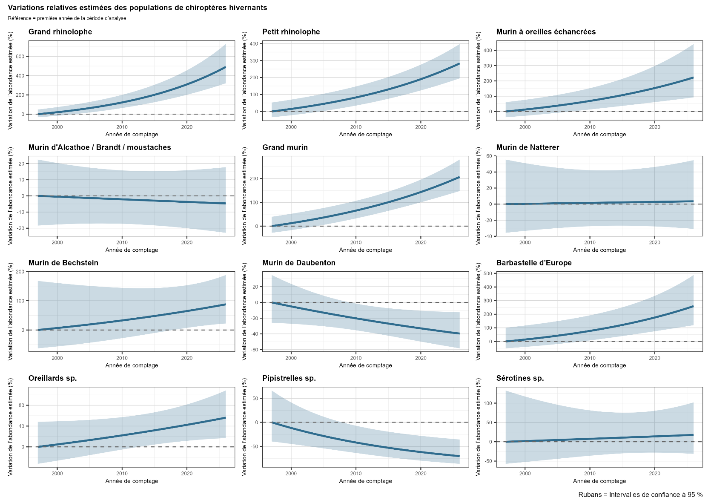
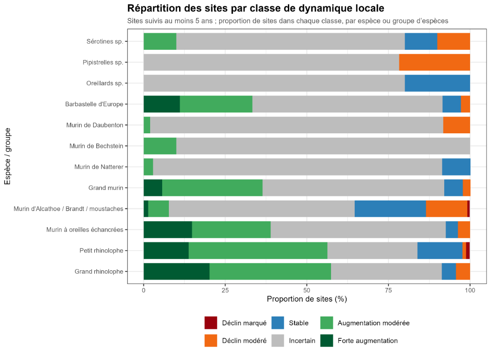

# Suivis hivernaux des chiroptères en Champagne-Ardenne

**Pierre FRENOIS — Master IEGB, 2025–2026**  
Étude réalisée en apprentissage au Conservatoire d’espaces naturels de Champagne-Ardenne.

## Présentation de l’étude

Cette étude porte sur les dynamiques spatio-temporelles des populations de chiroptères en hibernation dans les gîtes suivis en Champagne-Ardenne. Elle vise à valoriser les données de comptages hivernaux pour estimer les tendances régionales, identifier les dynamiques locales et orienter les priorités de suivi et de conservation.

Les analyses concernent **12 espèces ou groupes d’espèces**, de l’hiver **1996–1997 à 2025–2026**. Le jeu de données après nettoyage comprend **450 sites**, avec des durées et des fréquences de suivi variables.

## Méthodes

Les analyses ont été réalisées sous R. Le travail comprend le nettoyage et l’harmonisation des données, la description de l’effort de suivi, une exploration multivariée par AFC, puis la modélisation des tendances par espèce ou groupe d’espèces.

Les tendances régionales sont estimées à l’aide de modèles linéaires généralisés mixtes binomiaux négatifs, avec une pente et un intercept aléatoires par site. Les diagnostics sont examinés avec DHARMa. Une comparaison avec les sites suivis au moins dix ans permet d’évaluer la sensibilité des tendances à la durée du suivi.

Les dynamiques locales sont ensuite croisées avec l’intérêt chiroptérologique des gîtes, évalué selon la méthode SFEPM-CCN 2026, pour identifier les sites nécessitant une vigilance particulière.

## Effort de suivi

*Figure 3 du rapport. Nombre de sites suivis par hiver sur l’ensemble de la chronique disponible.*

Les premiers comptages remontent à l’hiver 1969–1970. Le nombre de sites suivis augmente nettement à partir de l’hiver 1996–1997, retenu comme début de la période d’analyse. La fréquence des passages et la durée des séries restent hétérogènes selon les sites.

## Tendances régionales

*Figure issue de l’annexe 10 du rapport. Les courbes représentent les variations relatives estimées par rapport à la première année d’analyse ; les rubans correspondent aux intervalles de confiance à 95 %.*

Six espèces ou groupes d’espèces présentent une tendance significative à l’échelle régionale : une augmentation pour le Grand rhinolophe, le Petit rhinolophe, le Murin à oreilles échancrées, le Grand murin et la Barbastelle d’Europe, et un déclin pour les Pipistrelles. Le modèle du Murin à oreilles échancrées sous-estime les zéros : son résultat doit être interprété avec prudence.

## Dynamiques locales et conservation

*Figure 12 du rapport. Répartition des sites suivis au moins cinq ans selon leur classe de dynamique locale estimée.*

Les tendances régionales masquent des situations locales contrastées. Une part importante des tendances par site reste incertaine. Le croisement avec l’intérêt chiroptérologique permet d’identifier cinq sites en priorité forte, qui cumulent un intérêt régional et au moins une dynamique locale défavorable.

Cette hiérarchisation constitue une aide à la décision. Elle doit être confrontée à la connaissance de terrain des gestionnaires, aux pressions locales et aux possibilités de protection. Les tendances des comptages restent également sensibles à la détectabilité, aux déplacements entre gîtes et à l’évolution de l’effort de prospection.

## Vigilance et gestion des gîtes

Le croisement de l’intérêt chiroptérologique et des dynamiques locales conduit aux niveaux de vigilance suivants, repris des résultats du rapport :

| Niveau de vigilance | Nombre de sites |
|---|---:|
| Priorité forte | 5 |
| Vigilance locale | 27 |
| Surveillance renforcée | 31 |
| Site majeur à maintenir | 8 |
| Surveillance simple | 146 |
| Suivi courant | 233 |

## Données

Les données proviennent de la base NCA, hébergée et administrée par le CEN Champagne-Ardenne, qui rassemble les comptages de plusieurs structures et observateurs.

Les données brutes, les noms et codes des gîtes, leurs coordonnées et les résultats détaillés par site restent privés. Seuls des résultats de synthèse sans localisation sont présentés ici. Le rapport complet n’est pas diffusé dans ce dépôt.
