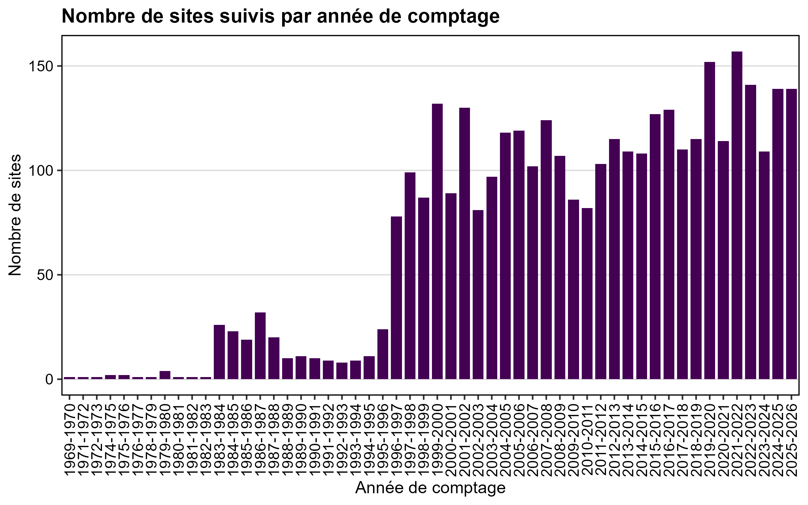
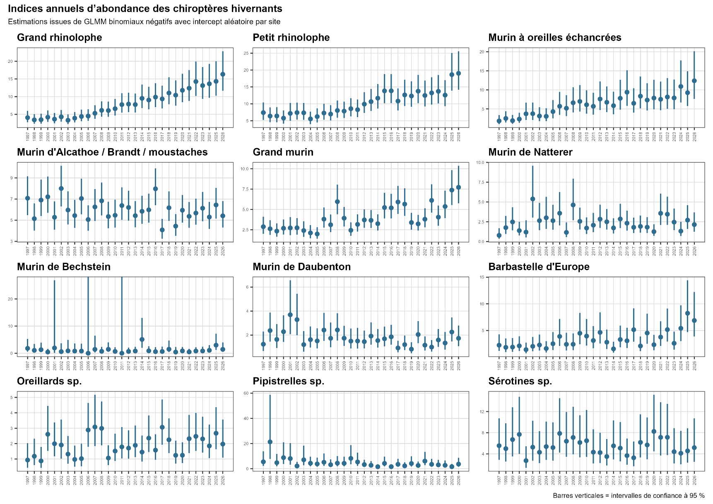

# Résultats de l’étude

[Retour à la présentation](../README.md)

Les figures ci-dessous sont extraites du rapport d’étude scientifique et technique de Pierre FRENOIS, Master IEGB 2025–2026. Les valeurs et graphiques sont ceux du rapport ; ils n’ont pas été recalculés pour ce dépôt.

## Effort de suivi

*Figure 3 du rapport. Nombre de sites suivis par hiver sur l’ensemble de la chronique disponible.*

Les premiers comptages remontent à l’hiver 1969–1970. Le nombre de sites suivis augmente nettement à partir de l’hiver 1996–1997, retenu comme début de la période d’analyse. La fréquence des passages et la durée des séries restent hétérogènes selon les sites.

## Tendances régionales

Les estimations ci-dessous correspondent aux modèles utilisant les sites suivis au moins trois ans et retenus après le filtre d’abondance. Elles sont reprises du tableau comparatif en annexe du rapport.

| Espèce / groupe | Variation annuelle estimée [IC 95 %] | p-value |
|---|---|---|
| Barbastelle d'Europe | 4,51 % [1,93 ; 7,15] | < 0,001 |
| Sérotines sp. | 0,57 % [-2,87 ; 4,13] | 0,751 |
| Murin d'Alcathoe / Brandt / moustaches | -0,17 % [-1 ; 0,67] | 0,698 |
| Murin de Bechstein | 2,19 % [-1,25 ; 5,76] | 0,215 |
| Murin de Daubenton | -1,73 % [-3,47 ; 0,05] | 0,056 |
| Murin à oreilles échancrées | 4,12 % [2,04 ; 6,24] | < 0,001 |
| Grand murin | 3,94 % [2,67 ; 5,23] | < 0,001 |
| Murin de Natterer | 0,12 % [-1,65 ; 1,92] | 0,897 |
| Pipistrelles sp. | -4,11 % [-6,95 ; -1,18] | 0,006 |
| Oreillards sp. | 1,55 % [-0,15 ; 3,27] | 0,074 |
| Grand rhinolophe | 6,32 % [4,77 ; 7,88] | < 0,001 |
| Petit rhinolophe | 4,74 % [3,37 ; 6,13] | < 0,001 |

Le Grand rhinolophe présente la plus forte augmentation annuelle estimée (+6,32 %), tandis que les Pipistrelles présentent une diminution annuelle de 4,11 %. Le Murin de Daubenton présente une estimation négative, mais sa tendance n’atteint pas le seuil de significativité de 5 % (p = 0,056). Le modèle du Murin à oreilles échancrées sous-estime les zéros ; ce résultat est donc à interpréter avec prudence.

## Estimations annuelles

*Figure 11 du rapport. Nombres moyens estimés par année à partir de modèles binomiaux négatifs avec intercept aléatoire par site. Les barres représentent les intervalles de confiance à 95 %.*

Ces estimations permettent de décrire les variations entre années en complément de la tendance moyenne sur l’ensemble de la période. L’incertitude est plus importante pour certains taxons, notamment ceux qui sont moins représentés dans les suivis.

## Vigilance et gestion des gîtes

Le croisement de l’intérêt chiroptérologique et des dynamiques locales conduit aux niveaux de vigilance suivants, repris des résultats du rapport :

| Niveau de vigilance | Nombre de sites |
|---|---:|
| Priorité forte | 5 |
| Vigilance locale | 27 |
| Surveillance renforcée | 31 |
| Site majeur à maintenir | 8 |
| Surveillance simple | 146 |
| Suivi courant | 233 |

Les listes et cartes des gîtes ne sont pas présentées afin de préserver leur confidentialité. Les tendances locales constituent des signaux de vigilance : elles ne suffisent pas, à elles seules, à établir les causes des variations ou à décider d’une mesure de gestion.
